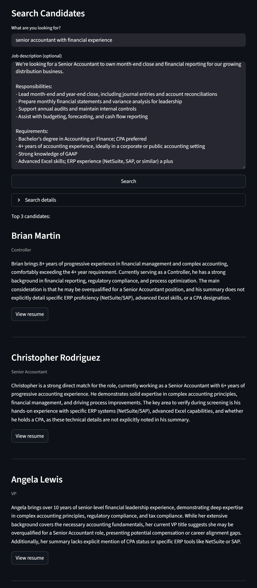
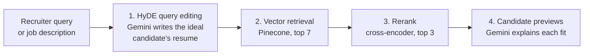

# HireFlow

**Semantic candidate search for recruiters.** Describe a role in plain language or paste a job description, and HireFlow finds the best-matching candidates by meaning rather than keywords, then explains why each one fits.

**Live demo:** https://hireflow-ip6qt4teta-uc.a.run.app
*(Scales to zero when idle. The first load may take 20–30 seconds.)*



---

## Features

- **Recruiter search:** natural-language queries or full job descriptions, matched semantically against every resume.
- **AI candidate previews:** a short, human-readable summary of each top candidate's fit for the role.
- **Resume viewer:** each result links to the original PDF through a short-lived signed URL; the storage bucket itself stays private.
- **Candidate uploads:** candidates submit a PDF with their email; returning candidates replace their previous resume instead of creating duplicates.

---

## How it works

### Retrieval: a four-stage RAG pipeline



1. **HyDE (Hypothetical Document Embeddings):** a short query and a resume look very different, so embedding the query directly matches poorly. Instead, Gemini writes the resume an ideal candidate *would* have, and that is embedded. It also produces a concise target-role description used for reranking.
2. **Retrieval:** the hypothetical resume is embedded with `gemini-embedding-001` and matched against stored resumes in Pinecone (top 7 by cosine similarity).
3. **Reranking:** a cross-encoder (`cross-encoder/ms-marco-MiniLM-L-6-v2`) scores each candidate against the target role directly. It's slower than vector search but more accurate, so it runs only on the shortlist (top 3).
4. **Previews:** Gemini writes a brief evaluation of each finalist, matched back to candidates by email so summaries can't get attached to the wrong person.

### Ingestion

When a candidate uploads a resume:

1. The PDF's text is extracted, and Gemini pulls out structured metadata and writes a concise summary of the candidate.
2. The file is uploaded to Google Cloud Storage.
3. The SQLite record is written but **not committed**.
4. The summary is embedded and upserted to Pinecone. A summary captures what matters for matching better than the full text would, and keeps each resume to a single vector.
5. SQLite commits only after Pinecone succeeds.

Steps that can fail without side effects (text extraction, the LLM call) run **before** anything is written, so a bad LLM response never leaves orphaned files. If Pinecone fails, the SQL write is rolled back and the uploaded file is deleted.

---

## Tech stack

| Area | Technology |
|---|---|
| UI | Streamlit |
| LLM & embeddings | Google Gemini (`gemini-embedding-001`, 768 dimensions) |
| Vector database | Pinecone |
| Reranking | sentence-transformers cross-encoder (CPU) |
| File storage | Google Cloud Storage |
| Metadata | SQLite |
| Testing | pytest |
| Container | Docker |
| Infrastructure | Terraform |
| CI/CD & hosting | Cloud Build, Artifact Registry, Cloud Run |

---

## Deployment

Every push to `main` is tested, built, and deployed automatically:

```
git push → Cloud Build trigger → pytest → docker build → Artifact Registry → Cloud Run
```

- **Infrastructure as code:** all cloud resources (service accounts, permissions, registry, secret, Cloud Run service, build trigger) are defined in Terraform.
- **Least privilege:** the app and the pipeline run as separate service accounts, each with only the permissions it needs.
- **No secrets in code or images:** API keys live in Secret Manager and are mounted into the container at runtime.
- **Safe deploys:** if any step fails (including tests), nothing deploys and the previous version keeps running.

See [DEPLOYMENT.md](DEPLOYMENT.md) for the full setup, workflow, and lessons learned.

---

## Key design decisions

- **Deterministic retrieval:** HyDE generation runs at `temperature=0`, so the same query returns the same candidates.
- **Embedding model is fixed, not configurable:** it's coupled to the 768-dimension Pinecone index; changing it would require re-embedding everything.
- **Separate role description and hypothetical resume:** HyDE produces both because they feed different stages (reranking vs. embedding).
- **Lazy-loaded cross-encoder:** the model loads once on first use instead of on every search, without tying the code to Streamlit's caching.
- **Fail loudly:** required config uses `os.environ["KEY"]` so a missing value fails at startup, not mid-request. Errors raise instead of returning `False`; the UI catches them, shows a friendly message, and logs the details.
- **Private bucket + signed URLs:** resumes contain personal data, so links are generated on demand and expire after 60 minutes. In Cloud Run, signing goes through the IAM API, since there's no key file in the container.
- **Config from the environment:** database path, Pinecone namespace, and storage prefix come from environment variables, so the same image runs locally and in the cloud.

---

## Project structure

```
├── app.py                    # Streamlit UI (candidate upload + recruiter search)
├── services/
│   ├── ingestion.py          # Resume ingestion workflow
│   └── retrieval.py          # Four-stage retrieval pipeline
├── utils/
│   ├── database.py           # SQLite access
│   ├── llm_helpers.py        # Parsing JSON from LLM replies
│   ├── pinecone_store.py     # Pinecone index + embeddings
│   ├── reranker.py           # Cross-encoder (lazy singleton)
│   ├── resume_processing.py  # PDF text + metadata extraction
│   └── upload_gcs_file.py    # GCS uploads + signed URLs
├── scripts/
│   └── batch_ingest.py       # Bulk-load a folder of resumes
├── tests/                    # pytest suite (external services faked)
├── terraform/                # Cloud infrastructure
├── Dockerfile
├── cloudbuild.yaml           # CI/CD pipeline
└── DEPLOYMENT.md
```

---

## Running locally

### Prerequisites
- Python 3.12
- A Google Cloud project with a GCS bucket and a service account key with access to it
- A Pinecone index: **768 dimensions, cosine metric**
- A Gemini API key

### Setup

```bash
git clone https://github.com/jslvrider/HireFlow-Project.git
cd HireFlow-Project

conda create -n hireflow python=3.12
conda activate hireflow
pip install -r requirements.txt
```

Copy `.env.example` to `.env` and fill in your values:

```bash
cp .env.example .env
```

### Load some resumes (optional)

```bash
python -m scripts.batch_ingest
```

### Run

```bash
streamlit run app.py
```

Then open http://localhost:8501.

### Run the tests

```bash
pip install -r requirements-dev.txt
pytest -v
```

The tests need no API keys: Gemini, Pinecone, and GCS are replaced with fakes.

---

## Known limitations

- **SQLite on a mounted bucket** limits the app to one Cloud Run instance (one writer at a time). Cloud SQL would remove this limit.
- **Rare partial failure:** if Pinecone succeeds but the final SQLite commit fails, the two stores disagree. Unlikely with a local SQLite file, so not handled.
- **Duplicates are detected by email only:** the same resume uploaded under a different email becomes a second candidate.
- **Cold starts:** the service scales to zero, so the first request after idle takes longer while the model loads.

## Future improvements

- An evaluation set to measure retrieval quality (e.g. how often the right candidate is in the top 3)
- Staging → approval → production pipeline with pull-request checks
- Cloud SQL instead of SQLite
- Duplicate detection by file hash
- Remote Terraform state